# TÀI LIỆU THIẾT KẾ CƠ SỞ DỮ LIỆU & KIẾN TRÚC LÕI
## HỆ THỐNG QUẢN LÝ CHUỖI NHÀ HÀNG BẾP VIỆT

- **Dự án**: Hệ thống Quản lý Chuỗi Nhà Hàng Bếp Việt (Đồ án tốt nghiệp)
- **Hệ quản trị CSDL**: PostgreSQL 18
- **Nền tảng Backend**: NestJS (TypeScript strict mode) + TypeORM
- **Mã tài liệu**: `docs/technical-design/01-database-and-core-architecture.md`
- **Tài liệu căn cứ**: `docs/business-requirements.md`

---

## 1. NGUYÊN TẮC THIẾT KẾ KIẾN TRÚC CỐT LÕI

Để đảm bảo hệ thống mở rộng tốt, vận hành ổn định và không bị sửa đổi schema nhiều lần trong quá trình phát triển, tài liệu này thiết lập 7 nguyên tắc bất biến:

### 1.1. Tách biệt Tài khoản đăng nhập (Auth Account) khỏi Hồ sơ nghiệp vụ
* Bảng `users` chỉ phục vụ mục đích **xác thực danh tính (Authentication)**: lưu email, số điện thoại, mật khẩu mã hóa (`password_hash`), trạng thái khóa và loại tài khoản (`account_type`).
* Hồ sơ nhân viên được lưu riêng ở bảng `employees` (quan hệ 1-1 với `users`, nhân viên bắt buộc phải có tài khoản đăng nhập).
* Hồ sơ khách hàng được lưu riêng ở bảng `customers` (quan hệ 1-1 với `users`, nhưng `user_id` là `nullable` để hỗ trợ khách vãng lai mua tại quán hoặc đặt bàn mà chưa tạo tài khoản).
* Hỗ trợ **Đăng nhập mạng xã hội (Google/Apple OAuth)** qua bảng riêng `auth_identities`. Người dùng đăng nhập bằng Google sẽ có `users.password_hash = NULL` và liên kết bản ghi `(provider = 'google', provider_user_id = sub)` trong `auth_identities`.

### 1.2. Quy ước Định danh (ID Convention) & Kiểu dữ liệu
* **Khóa chính (PK)**: Sử dụng kiểu **`BIGINT`** (tự tăng `bigserial`) trong PostgreSQL. Trên tầng TypeScript/NestJS, giá trị được ánh xạ thành kiểu **`string`** (kế thừa từ `BaseEntity` hoặc `SoftDeleteBaseEntity`) để triệt tiêu hoàn toàn rủi ro mất độ chính xác số học 64-bit của JavaScript và tương thích chuẩn JSON API quốc tế.
* **Khóa ngoại (FK)**: Sử dụng kiểu **`BIGINT`** (trên TypeScript là `string` hoặc `string | null`).
* **Thời gian**: Sử dụng kiểu **`TIMESTAMPTZ`** (Timestamp with Time Zone) lưu trữ theo chuẩn UTC để bảo đảm tính chính xác khi mở rộng chi nhánh đa múi giờ.
* **Tiền tệ (VND)**: Sử dụng **`DECIMAL(15, 2)`** để bảo toàn tính toán tài chính và giá trị đơn hàng, không dùng float/double.
* **Bảng danh mục nhỏ nội bộ**: Các bảng số lượng bản ghi cố định dưới vài trăm dòng (`roles`, `permissions`, `menu_categories`, `membership_tiers`, `option_groups`) dùng `SERIAL` (32-bit integer, trên TypeScript là `number`).

### 1.3. Tính bất biến và Lưu vết Snapshot của Đơn hàng (Immutability)
* Đơn hàng (`orders`), chi tiết món (`order_items`) và tùy chọn món (`order_item_options`) bắt buộc phải **lưu snapshot đầy đủ**:
  * Tên món (`item_name_snapshot`)
  * Tên tùy chọn / topping (`option_name_snapshot`)
  * Giá bán tại thời điểm đặt (`unit_price`, `price_delta_snapshot`)
  * Giá vốn tại thời điểm bán (`unit_cost_snapshot` phục vụ báo cáo lợi nhuận gộp)
* Mọi thay đổi giá, đổi tên món hoặc xóa món trong menu tương lai **tuyệt đối không làm thay đổi lịch sử hóa đơn cũ**.

### 1.4. Quản lý Thực đơn và Giá theo từng Chi nhánh (Branch-specific Menu)
* Bảng `menu_items` định nghĩa thông tin gốc của món ăn toàn chuỗi.
* Bảng `branch_menu_items` quản lý việc chi nhánh nào bán món gì, giá bán riêng tại chi nhánh đó (nếu có chính sách giá khác nhau), giá vốn và trạng thái tồn kho độc lập (`AVAILABLE`, `OUT_OF_STOCK`, `HIDDEN`).

### 1.5. Phân ca làm việc hai tầng (Two-tier Shift Scheduling)
* **Tầng 1 - Khung ca mẫu (`work_shifts`)**: Định nghĩa các ca chuẩn của chi nhánh (ví dụ: Ca Sáng 06:00 - 14:00, Ca Tối 14:00 - 22:00).
* **Tầng 2 - Lịch phân ca thực tế (`employee_shift_assignments`)**: Gán một nhân viên cụ thể vào một ca cụ thể trong một ngày làm việc cụ thể (`work_date`), kèm theo trạng thái chấm công (`SCHEDULED`, `CONFIRMED`, `COMPLETED`, `ABSENT`).

### 1.6. Ràng buộc Khuyến mãi chặt chẽ (Promotion Engine)
* Khuyến mãi có giới hạn phạm vi chi nhánh áp dụng (`promotion_branches`), giới hạn ngân sách/lượt dùng (`usage_limit`, `per_customer_limit`), điều kiện giá trị đơn tối thiểu (`min_order_amount`) và chỉ áp dụng cho đơn đầu tiên (`is_first_order_only`).

### 1.7. Quy chế Xóa mềm (Soft Delete)
* Các bảng chứa dữ liệu master quan trọng (`users`, `employees`, `branches`, `menu_items`, `customers`) đều có cột `deleted_at timestamptz`. Khi xóa, bản ghi chỉ được đánh dấu mốc thời gian, không xóa cứng (hard delete) nhằm bảo toàn tính toàn vẹn dữ liệu kế toán và phân tích.

---

## 2. SƠ ĐỒ QUAN HỆ THỰC THỂ TỔNG THỂ (ERD)

```mermaid
erDiagram
    users ||--o| employees : "1-1 (user_id)"
    users ||--o| customers : "1-1 (user_id, nullable)"
    users ||--o{ auth_identities : "1-N (oauth)"
    
    roles ||--o{ role_permissions : "1-N"
    permissions ||--o{ role_permissions : "1-N"
    
    employees ||--o{ employee_branch_assignments : "1-N"
    branches ||--o{ employee_branch_assignments : "1-N"
    roles ||--o{ employee_branch_assignments : "1-N"
    employee_branch_assignments ||--o{ employee_permissions : "1-N"
    permissions ||--o{ employee_permissions : "1-N"
    
    branches ||--o{ branch_opening_hours : "1-N"
    branches ||--o{ work_shifts : "1-N"
    work_shifts ||--o{ employee_shift_assignments : "1-N"
    employee_branch_assignments ||--o{ employee_shift_assignments : "1-N"
    
    menu_categories ||--o{ menu_items : "1-N"
    branches ||--o{ branch_menu_items : "1-N"
    menu_items ||--o{ branch_menu_items : "1-N"
    
    menu_items ||--o{ menu_item_option_groups : "1-N"
    option_groups ||--o{ menu_item_option_groups : "1-N"
    option_groups ||--o{ menu_item_options : "1-N"
    
    customers ||--o{ customer_addresses : "1-N"
    membership_tiers ||--o{ customer_memberships : "1-N"
    customers ||--|| customer_memberships : "1-1"
    customers ||--o{ loyalty_transactions : "1-N"
    
    branches ||--o{ orders : "1-N"
    customers ||--o{ orders : "1-N"
    orders ||--o{ order_items : "1-N"
    menu_items ||--o{ order_items : "1-N"
    order_items ||--o{ order_item_options : "1-N"
    menu_item_options ||--o{ order_item_options : "1-N"
    orders ||--o{ order_status_histories : "1-N"
    orders ||--o{ payments : "1-N"
    orders ||--o| deliveries : "1-1"
    employees ||--o{ deliveries : "shipper"
    
    promotions ||--o{ promotion_branches : "1-N"
    branches ||--o{ promotion_branches : "1-N"
    promotions ||--o{ promotion_usages : "1-N"
    orders ||--o| promotion_usages : "1-1"
    
    orders ||--o| reviews : "1-1"
    reviews ||--o{ review_replies : "1-N"
    employees ||--o{ review_replies : "1-N"
```



---

## 3. CHI TIẾT CÁC THỰC THỂ DỮ LIỆU

---

### PHÂN HỆ 1: XÁC THỰC & PHÂN QUYỀN (AUTH & RBAC)

#### 1. Bảng `users` (Tài khoản xác thực trung tâm)
*Kế thừa: `SoftDeleteBaseEntity`*

| Tên cột | Kiểu PostgreSQL | Null | Mặc định | Kiểu TS | Mô tả |
| :--- | :--- | :---: | :---: | :---: | :--- |
| `id` | `BIGSERIAL` | NO | Tự tăng | `string` | Khóa chính |
| `email` | `VARCHAR(255)` | YES | NULL | `string \| null` | Email đăng nhập (duy nhất) |
| `phone` | `VARCHAR(20)` | YES | NULL | `string \| null` | Số điện thoại (duy nhất) |
| `password_hash` | `VARCHAR(255)` | YES | NULL | `string \| null` | Mật khẩu băm (NULL nếu chỉ dùng Google OAuth) |
| `account_type` | `VARCHAR(30)` | NO | 'CUSTOMER' | `string` | Phân loại: `STAFF`, `CUSTOMER`, `ADMIN` |
| `is_active` | `BOOLEAN` | NO | `true` | `boolean` | Trạng thái kích hoạt tài khoản |
| `created_at` | `TIMESTAMPTZ` | NO | `now()` | `Date` | Thời điểm tạo |
| `updated_at` | `TIMESTAMPTZ` | YES | NULL | `Date \| null` | Thời điểm cập nhật |
| `deleted_at` | `TIMESTAMPTZ` | YES | NULL | `Date \| null` | Thời điểm xóa mềm |

* **Ràng buộc**: `CONSTRAINT pk_users PRIMARY KEY (id)`, `CONSTRAINT uq_users_email UNIQUE (email)`, `CONSTRAINT uq_users_phone UNIQUE (phone)`.

---

#### 2. Bảng `auth_identities` (Đăng nhập mạng xã hội / Google OAuth)
*Kế thừa: `BaseEntity`*

| Tên cột | Kiểu PostgreSQL | Null | Mặc định | Kiểu TS | Mô tả |
| :--- | :--- | :---: | :---: | :---: | :--- |
| `id` | `BIGSERIAL` | NO | Tự tăng | `string` | Khóa chính |
| `user_id` | `BIGINT` | NO | - | `string` | FK -> `users.id` |
| `provider` | `VARCHAR(30)` | NO | - | `string` | Nhà cung cấp: `google`, `apple`, `facebook` |
| `provider_user_id`| `VARCHAR(255)` | NO | - | `string` | ID định danh phía OAuth trả về (`sub`) |
| `created_at` | `TIMESTAMPTZ` | NO | `now()` | `Date` | Thời điểm liên kết |

* **Ràng buộc & Index**: 
  * `CONSTRAINT uq_auth_identities_provider_sub UNIQUE (provider, provider_user_id)`
  * `INDEX idx_auth_identities_user (user_id)`

---

#### 3. Bảng `employees` (Hồ sơ nhân viên)
*Kế thừa: `SoftDeleteBaseEntity`*

| Tên cột | Kiểu PostgreSQL | Null | Mặc định | Kiểu TS | Mô tả |
| :--- | :--- | :---: | :---: | :---: | :--- |
| `id` | `BIGSERIAL` | NO | Tự tăng | `string` | Khóa chính |
| `user_id` | `BIGINT` | NO | - | `string` | FK -> `users.id` (1-1 duy nhất) |
| `full_name` | `VARCHAR(150)` | NO | - | `string` | Họ và tên nhân viên |
| `contact_phone` | `VARCHAR(20)` | YES | NULL | `string \| null` | Số điện thoại liên hệ cá nhân |
| `hire_date` | `DATE` | YES | NULL | `string \| null` | Ngày bắt đầu làm việc |
| `employment_status`| `VARCHAR(30)` | NO | 'ACTIVE' | `string` | Trạng thái: `ACTIVE`, `INACTIVE`, `ON_LEAVE` |
| `created_at` | `TIMESTAMPTZ` | NO | `now()` | `Date` | Thời điểm tạo |
| `updated_at` | `TIMESTAMPTZ` | YES | NULL | `Date \| null` | Thời điểm cập nhật |
| `deleted_at` | `TIMESTAMPTZ` | YES | NULL | `Date \| null` | Thời điểm xóa mềm |

* **Ràng buộc**: `CONSTRAINT uq_employees_user_id UNIQUE (user_id)`.

---

#### 4. Bảng `roles` (Vai trò nội bộ)
| Tên cột | Kiểu PostgreSQL | Null | Mặc định | Kiểu TS | Mô tả |
| :--- | :--- | :---: | :---: | :---: | :--- |
| `id` | `SERIAL` | NO | Tự tăng | `number` | Khóa chính (1, 2, 3...) |
| `code` | `VARCHAR(50)` | NO | - | `string` | Mã vai trò: `BRANCH_MANAGER`, `CHEF`, `CASHIER`, `WAITER`, `SHIPPER` |
| `name` | `VARCHAR(100)` | NO | - | `string` | Tên hiển thị vai trò |
| `description` | `TEXT` | YES | NULL | `string \| null` | Mô tả trách nhiệm |
| `created_at` | `TIMESTAMPTZ` | YES | `now()` | `Date` | Thời điểm tạo |

---

#### 5. Bảng `permissions` (Danh mục quyền hệ thống)
| Tên cột | Kiểu PostgreSQL | Null | Mặc định | Kiểu TS | Mô tả |
| :--- | :--- | :---: | :---: | :---: | :--- |
| `id` | `SERIAL` | NO | Tự tăng | `number` | Khóa chính |
| `code` | `VARCHAR(100)`| NO | - | `string` | Mã quyền: `order:view`, `order:update_status`, `menu:manage`... |
| `name` | `VARCHAR(150)`| NO | - | `string` | Tên quyền |
| `description` | `TEXT` | YES | NULL | `string \| null` | Mô tả chi tiết phạm vi quyền |

---

#### 6. Bảng `role_permissions` (Gán quyền cho vai trò)
| Tên cột | Kiểu PostgreSQL | Null | Mặc định | Kiểu TS | Mô tả |
| :--- | :--- | :---: | :---: | :---: | :--- |
| `role_id` | `INTEGER` | NO | - | `number` | FK -> `roles.id` |
| `permission_id` | `INTEGER` | NO | - | `number` | FK -> `permissions.id` |
| `created_at` | `TIMESTAMPTZ` | YES | `now()` | `Date` | Thời điểm gán |

* **Ràng buộc**: `CONSTRAINT pk_role_permissions PRIMARY KEY (role_id, permission_id)`.

---

#### 7. Bảng `employee_branch_assignments` (Phân công nhân viên vào chi nhánh)
*Kế thừa: `BaseEntity`*

| Tên cột | Kiểu PostgreSQL | Null | Mặc định | Kiểu TS | Mô tả |
| :--- | :--- | :---: | :---: | :---: | :--- |
| `id` | `BIGSERIAL` | NO | Tự tăng | `string` | Khóa chính |
| `employee_id` | `BIGINT` | NO | - | `string` | FK -> `employees.id` |
| `branch_id` | `BIGINT` | NO | - | `string` | FK -> `branches.id` |
| `role_id` | `INTEGER` | NO | - | `number` | FK -> `roles.id` |
| `start_date` | `DATE` | NO | - | `string` | Ngày bắt đầu phân công |
| `end_date` | `DATE` | YES | NULL | `string \| null` | Ngày kết thúc phân công |
| `status` | `VARCHAR(30)` | NO | 'ACTIVE' | `string` | Trạng thái: `ACTIVE`, `ENDED`, `SUSPENDED` |
| `created_at` | `TIMESTAMPTZ` | YES | `now()` | `Date` | Thời điểm tạo |

---

#### 8. Bảng `employee_permissions` (Quyền tùy biến ghi đè cho nhân viên)
| Tên cột | Kiểu PostgreSQL | Null | Mặc định | Kiểu TS | Mô tả |
| :--- | :--- | :---: | :---: | :---: | :--- |
| `assignment_id` | `BIGINT` | NO | - | `string` | FK -> `employee_branch_assignments.id` |
| `permission_id` | `INTEGER` | NO | - | `number` | FK -> `permissions.id` |
| `allowed` | `BOOLEAN` | NO | - | `boolean` | `true`: Cấp thêm quyền; `false`: Chặn quyền |
| `created_at` | `TIMESTAMPTZ` | YES | `now()` | `Date` | Thời điểm cấu hình |

* **Ràng buộc**: `CONSTRAINT pk_employee_permissions PRIMARY KEY (assignment_id, permission_id)`.

---

### PHÂN HỆ 2: QUẢN LÝ CHI NHÁNH (BRANCH MANAGEMENT)

#### 9. Bảng `branches` (Chi nhánh nhà hàng)
*Kế thừa: `SoftDeleteBaseEntity`*

| Tên cột | Kiểu PostgreSQL | Null | Mặc định | Kiểu TS | Mô tả |
| :--- | :--- | :---: | :---: | :---: | :--- |
| `id` | `BIGSERIAL` | NO | Tự tăng | `string` | Khóa chính |
| `code` | `VARCHAR(50)` | NO | - | `string` | Mã chi nhánh (duy nhất, ví dụ: `BV-HN-01`) |
| `name` | `VARCHAR(150)` | NO | - | `string` | Tên chi nhánh |
| `address` | `TEXT` | NO | - | `string` | Địa chỉ cơ sở |
| `hotline` | `VARCHAR(20)` | YES | NULL | `string \| null` | Hotline chi nhánh |
| `manager_employee_id` | `BIGINT` | YES | NULL | `string \| null` | FK -> `employees.id` (Quản lý trưởng cơ sở) |
| `latitude` | `DECIMAL(10, 7)`| YES | NULL | `string \| null` | Tọa độ Vĩ độ |
| `longitude` | `DECIMAL(10, 7)`| YES | NULL | `string \| null` | Tọa độ Kinh độ |
| `allow_dine_in`| `BOOLEAN` | NO | `true` | `boolean` | Kênh ăn tại quán |
| `allow_online_order`| `BOOLEAN`| NO | `true` | `boolean` | Kênh đặt trước mang về |
| `delivery_radius_km`| `DECIMAL(8, 2)`| YES | `5.00` | `string \| null` | Bán kính giao hàng tối đa (km) |
| `status` | `VARCHAR(30)` | NO | 'OPEN' | `string` | Trạng thái: `OPEN`, `CLOSED`, `INACTIVE` |
| `created_at` | `TIMESTAMPTZ` | NO | `now()` | `Date` | Thời điểm tạo |
| `updated_at` | `TIMESTAMPTZ` | YES | NULL | `Date \| null` | Thời điểm cập nhật |
| `deleted_at` | `TIMESTAMPTZ` | YES | NULL | `Date \| null` | Thời điểm xóa mềm |

---

#### 10. Bảng `branch_opening_hours` (Khung giờ mở cửa chi nhánh)
| Tên cột | Kiểu PostgreSQL | Null | Mặc định | Kiểu TS | Mô tả |
| :--- | :--- | :---: | :---: | :---: | :--- |
| `branch_id` | `BIGINT` | NO | - | `string` | FK -> `branches.id` |
| `day_of_week` | `VARCHAR(15)` | NO | - | `string` | Thứ trong tuần: `MONDAY` .. `SUNDAY` |
| `period_no` | `INTEGER` | NO | 1 | `number` | Thứ tự ca mở cửa trong ngày |
| `open_time` | `TIME` | YES | NULL | `string \| null` | Giờ mở (ví dụ: `07:00:00`) |
| `close_time` | `TIME` | YES | NULL | `string \| null` | Giờ đóng (ví dụ: `22:00:00`) |
| `is_closed` | `BOOLEAN` | NO | `false` | `boolean` | `true` nếu ngày đó nghỉ |

* **Ràng buộc**: `CONSTRAINT pk_branch_opening_hours PRIMARY KEY (branch_id, day_of_week, period_no)`.

---

### PHÂN HỆ 3: THỰC ĐƠN & MÓN ĂN (MENU MANAGEMENT)

#### 11. Bảng `menu_categories` (Danh mục món ăn)
| Tên cột | Kiểu PostgreSQL | Null | Mặc định | Kiểu TS | Mô tả |
| :--- | :--- | :---: | :---: | :---: | :--- |
| `id` | `SERIAL` | NO | Tự tăng | `number` | Khóa chính |
| `name` | `VARCHAR(150)` | NO | - | `string` | Tên danh mục (Phở, Bún, Cơm, Đồ uống, Combo) |
| `description` | `TEXT` | YES | NULL | `string \| null` | Mô tả danh mục |
| `display_order`| `INTEGER` | NO | 0 | `number` | Thứ tự hiển thị |
| `status` | `VARCHAR(30)` | NO | 'ACTIVE' | `string` | Trạng thái: `ACTIVE`, `INACTIVE` |
| `created_at` | `TIMESTAMPTZ` | YES | `now()` | `Date` | Thời điểm tạo |
| `updated_at` | `TIMESTAMPTZ` | YES | NULL | `Date \| null` | Thời điểm cập nhật |

---

#### 12. Bảng `menu_items` (Món ăn)
*Kế thừa: `SoftDeleteBaseEntity`*

| Tên cột | Kiểu PostgreSQL | Null | Mặc định | Kiểu TS | Mô tả |
| :--- | :--- | :---: | :---: | :---: | :--- |
| `id` | `BIGSERIAL` | NO | Tự tăng | `string` | Khóa chính |
| `category_id` | `INTEGER` | NO | - | `number` | FK -> `menu_categories.id` |
| `name` | `VARCHAR(200)` | NO | - | `string` | Tên món ăn |
| `description` | `TEXT` | YES | NULL | `string \| null` | Mô tả chi tiết món |
| `image_url` | `VARCHAR(500)` | YES | NULL | `string \| null` | Đường dẫn ảnh đại diện |
| `status` | `VARCHAR(30)` | NO | 'ACTIVE' | `string` | Trạng thái toàn hệ thống: `ACTIVE`, `INACTIVE` |
| `created_at` | `TIMESTAMPTZ` | NO | `now()` | `Date` | Thời điểm tạo |
| `updated_at` | `TIMESTAMPTZ` | YES | NULL | `Date \| null` | Thời điểm cập nhật |
| `deleted_at` | `TIMESTAMPTZ` | YES | NULL | `Date \| null` | Thời điểm xóa mềm |

---

#### 13. Bảng `branch_menu_items` (Món ăn tại từng chi nhánh)
| Tên cột | Kiểu PostgreSQL | Null | Mặc định | Kiểu TS | Mô tả |
| :--- | :--- | :---: | :---: | :---: | :--- |
| `branch_id` | `BIGINT` | NO | - | `string` | FK -> `branches.id` |
| `menu_item_id` | `BIGINT` | NO | - | `string` | FK -> `menu_items.id` |
| `price` | `DECIMAL(15, 2)`| NO | - | `string` | Giá bán hiện tại tại chi nhánh (VND) |
| `cost_price` | `DECIMAL(15, 2)`| YES | NULL | `string \| null` | Giá vốn tại chi nhánh (VND) |
| `sale_status` | `VARCHAR(30)` | NO | 'AVAILABLE'| `string` | Trạng thái: `AVAILABLE`, `OUT_OF_STOCK`, `HIDDEN` |
| `updated_at` | `TIMESTAMPTZ` | YES | `now()` | `Date \| null` | Thời điểm cập nhật trạng thái |

* **Ràng buộc**: `CONSTRAINT pk_branch_menu_items PRIMARY KEY (branch_id, menu_item_id)`.

---

#### 14. Bảng `option_groups` (Nhóm tùy chọn món)
| Tên cột | Kiểu PostgreSQL | Null | Mặc định | Kiểu TS | Mô tả |
| :--- | :--- | :---: | :---: | :---: | :--- |
| `id` | `SERIAL` | NO | Tự tăng | `number` | Khóa chính |
| `name` | `VARCHAR(150)` | NO | - | `string` | Tên nhóm (Kích cỡ, Mức đường, Topping, Đồ ăn kèm) |
| `description` | `TEXT` | YES | NULL | `string \| null` | Mô tả |
| `status` | `VARCHAR(30)` | NO | 'ACTIVE' | `string` | Trạng thái: `ACTIVE`, `INACTIVE` |
| `created_at` | `TIMESTAMPTZ` | YES | `now()` | `Date` | Thời điểm tạo |

---

#### 15. Bảng `menu_item_option_groups` (Liên kết món với nhóm tùy chọn)
| Tên cột | Kiểu PostgreSQL | Null | Mặc định | Kiểu TS | Mô tả |
| :--- | :--- | :---: | :---: | :---: | :--- |
| `menu_item_id` | `BIGINT` | NO | - | `string` | FK -> `menu_items.id` |
| `option_group_id`| `INTEGER` | NO | - | `number` | FK -> `option_groups.id` |
| `selection_type` | `VARCHAR(20)` | NO | 'SINGLE' | `string` | Loại chọn: `SINGLE` (chọn 1), `MULTIPLE` (chọn nhiều) |
| `is_required` | `BOOLEAN` | NO | `false` | `boolean` | Bắt buộc phải chọn hay không |
| `min_select` | `INTEGER` | NO | 0 | `number` | Số lượng chọn tối thiểu |
| `max_select` | `INTEGER` | NO | 1 | `number` | Số lượng chọn tối đa |
| `display_order`| `INTEGER` | YES | 0 | `number` | Thứ tự hiển thị |

* **Ràng buộc**: `CONSTRAINT pk_menu_item_option_groups PRIMARY KEY (menu_item_id, option_group_id)`.

---

#### 16. Bảng `menu_item_options` (Các tùy chọn / Topping cụ thể)
*Kế thừa: `BaseEntity`*

| Tên cột | Kiểu PostgreSQL | Null | Mặc định | Kiểu TS | Mô tả |
| :--- | :--- | :---: | :---: | :---: | :--- |
| `id` | `BIGSERIAL` | NO | Tự tăng | `string` | Khóa chính |
| `option_group_id`| `INTEGER` | NO | - | `number` | FK -> `option_groups.id` |
| `name` | `VARCHAR(150)` | NO | - | `string` | Tên tùy chọn (Size Nhỏ, Size Lớn, Trứng chần, Quẩy...) |
| `price_delta` | `DECIMAL(15, 2)`| NO | `0.00` | `string` | Giá điều chỉnh cộng hoặc trừ (VND) |
| `status` | `VARCHAR(30)` | NO | 'ACTIVE' | `string` | Trạng thái: `ACTIVE`, `INACTIVE` |
| `display_order`| `INTEGER` | YES | 0 | `number` | Thứ tự hiển thị |
| `created_at` | `TIMESTAMPTZ` | YES | `now()` | `Date` | Thời điểm tạo |

---

### PHÂN HỆ 4: KHÁCH HÀNG & CRM (CUSTOMER & LOYALTY)

#### 17. Bảng `customers` (Hồ sơ khách hàng)
*Kế thừa: `SoftDeleteBaseEntity`*

| Tên cột | Kiểu PostgreSQL | Null | Mặc định | Kiểu TS | Mô tả |
| :--- | :--- | :---: | :---: | :---: | :--- |
| `id` | `BIGSERIAL` | NO | Tự tăng | `string` | Khóa chính |
| `user_id` | `BIGINT` | YES | NULL | `string \| null` | FK -> `users.id` (NULL nếu là khách vãng lai) |
| `full_name` | `VARCHAR(150)` | NO | - | `string` | Họ và tên khách hàng |
| `created_at` | `TIMESTAMPTZ` | NO | `now()` | `Date` | Thời điểm tạo |
| `updated_at` | `TIMESTAMPTZ` | YES | NULL | `Date \| null` | Thời điểm cập nhật |
| `deleted_at` | `TIMESTAMPTZ` | YES | NULL | `Date \| null` | Thời điểm xóa mềm |

* **Ràng buộc**: `CONSTRAINT uq_customers_user_id UNIQUE (user_id)`.

---

#### 18. Bảng `customer_addresses` (Sổ địa chỉ giao hàng của khách)
*Kế thừa: `BaseEntity`*

| Tên cột | Kiểu PostgreSQL | Null | Mặc định | Kiểu TS | Mô tả |
| :--- | :--- | :---: | :---: | :---: | :--- |
| `id` | `BIGSERIAL` | NO | Tự tăng | `string` | Khóa chính |
| `customer_id` | `BIGINT` | NO | - | `string` | FK -> `customers.id` |
| `recipient_name`| `VARCHAR(150)` | NO | - | `string` | Tên người nhận hàng |
| `phone` | `VARCHAR(20)` | NO | - | `string` | Số điện thoại nhận hàng |
| `address_line` | `VARCHAR(255)` | NO | - | `string` | Địa chỉ cụ thể (Số nhà, tên đường) |
| `ward` | `VARCHAR(100)` | YES | NULL | `string \| null` | Phường / Xã |
| `district` | `VARCHAR(100)` | YES | NULL | `string \| null` | Quận / Huyện |
| `city` | `VARCHAR(100)` | YES | NULL | `string \| null` | Tỉnh / Thành phố |
| `latitude` | `DECIMAL(10, 7)`| YES | NULL | `string \| null` | Tọa độ giao hàng |
| `longitude` | `DECIMAL(10, 7)`| YES | NULL | `string \| null` | Tọa độ giao hàng |
| `is_default` | `BOOLEAN` | NO | `false` | `boolean` | Là địa chỉ mặc định |
| `created_at` | `TIMESTAMPTZ` | YES | `now()` | `Date` | Thời điểm tạo |

---

#### 19. Bảng `membership_tiers` (Hạng thành viên)
| Tên cột | Kiểu PostgreSQL | Null | Mặc định | Kiểu TS | Mô tả |
| :--- | :--- | :---: | :---: | :---: | :--- |
| `id` | `SERIAL` | NO | Tự tăng | `number` | Khóa chính |
| `code` | `VARCHAR(30)` | NO | - | `string` | Mã hạng: `NEW`, `BRONZE`, `SILVER`, `GOLD` |
| `name` | `VARCHAR(100)` | NO | - | `string` | Tên hiển thị hạng |
| `min_lifetime_spend`| `DECIMAL(15, 2)`| NO | `0.00`| `string` | Chi tiêu tối thiểu tích lũy trọn đời để đạt hạng |
| `description` | `TEXT` | YES | NULL | `string \| null` | Đặc quyền của hạng |
| `sort_order` | `INTEGER` | YES | 0 | `number` | Thứ tự cấp bậc |
| `status` | `VARCHAR(30)` | NO | 'ACTIVE' | `string` | Trạng thái |

---

#### 20. Bảng `customer_memberships` (Điểm thưởng và hạng hiện tại của khách)
| Tên cột | Kiểu PostgreSQL | Null | Mặc định | Kiểu TS | Mô tả |
| :--- | :--- | :---: | :---: | :---: | :--- |
| `customer_id` | `BIGINT` | NO | - | `string` | Khóa chính & FK -> `customers.id` (1-1) |
| `tier_id` | `INTEGER` | NO | - | `number` | FK -> `membership_tiers.id` |
| `points_balance`| `INTEGER` | NO | 0 | `number` | Số điểm tích lũy hiện có |
| `lifetime_spend`| `DECIMAL(15, 2)`| NO | `0.00` | `string` | Tổng tiền đã chi tiêu tích lũy trọn đời (VND) |
| `updated_at` | `TIMESTAMPTZ` | YES | `now()` | `Date \| null` | Thời điểm cập nhật gần nhất |

* **Ràng buộc**: `CONSTRAINT pk_customer_memberships PRIMARY KEY (customer_id)`.

---

#### 21. Bảng `loyalty_transactions` (Lịch sử giao dịch điểm tích lũy)
*Kế thừa: `BaseEntity`*

| Tên cột | Kiểu PostgreSQL | Null | Mặc định | Kiểu TS | Mô tả |
| :--- | :--- | :---: | :---: | :---: | :--- |
| `id` | `BIGSERIAL` | NO | Tự tăng | `string` | Khóa chính |
| `customer_id` | `BIGINT` | NO | - | `string` | FK -> `customers.id` |
| `order_id` | `BIGINT` | YES | NULL | `string \| null` | FK -> `orders.id` (nếu giao dịch gắn với đơn) |
| `transaction_type`| `VARCHAR(30)`| NO | - | `string` | Loại: `EARN` (cộng), `REDEEM` (tiêu), `ADJUST`, `EXPIRE` |
| `points_delta` | `INTEGER` | NO | - | `number` | Số điểm biến động (+100 hoặc -50) |
| `description` | `TEXT` | YES | NULL | `string \| null` | Lý do biến động điểm |
| `created_at` | `TIMESTAMPTZ` | NO | `now()` | `Date` | Thời điểm phát sinh |

---

### PHÂN HỆ 5: ĐƠN HÀNG & THANH TOÁN (ORDER & PAYMENT)

#### 22. Bảng `orders` (Đơn hàng)
*Kế thừa: `BaseEntity`*

| Tên cột | Kiểu PostgreSQL | Null | Mặc định | Kiểu TS | Mô tả |
| :--- | :--- | :---: | :---: | :---: | :--- |
| `id` | `BIGSERIAL` | NO | Tự tăng | `string` | Khóa chính |
| `order_code` | `VARCHAR(50)` | NO | - | `string` | Mã đơn đọc được (VD: `ORD-20261114-0001`, duy nhất) |
| `branch_id` | `BIGINT` | NO | - | `string` | FK -> `branches.id` |
| `customer_id` | `BIGINT` | YES | NULL | `string \| null` | FK -> `customers.id` (NULL nếu khách vãng lai) |
| `channel` | `VARCHAR(30)` | NO | - | `string` | Kênh: `DINE_IN`, `ONLINE`, `DELIVERY` |
| `status` | `VARCHAR(30)` | NO | 'NEW' | `string` | Vòng đời đơn: `NEW`, `CONFIRMED`, `PREPARING`, `READY`, `DELIVERING`, `COMPLETED`, `CANCELLED` |
| `customer_name_snapshot` | `VARCHAR(150)`| YES | NULL | `string \| null` | Tên khách chụp lại lúc đặt |
| `customer_phone_snapshot`| `VARCHAR(20)` | YES | NULL | `string \| null` | SĐT khách chụp lại lúc đặt |
| `subtotal_amount` | `DECIMAL(15, 2)`| NO | - | `string` | Tổng tiền hàng ban đầu (chưa giảm giá/ship) |
| `discount_amount` | `DECIMAL(15, 2)`| NO | `0.00` | `string` | Tiền giảm giá |
| `delivery_fee` | `DECIMAL(15, 2)`| NO | `0.00` | `string` | Phí giao hàng |
| `total_amount` | `DECIMAL(15, 2)`| NO | - | `string` | Tổng tiền thanh toán cuối cùng |
| `note` | `TEXT` | YES | NULL | `string \| null` | Ghi chú của khách khi đặt món |
| `created_at` | `TIMESTAMPTZ` | NO | `now()` | `Date` | Thời điểm tạo đơn |
| `updated_at` | `TIMESTAMPTZ` | YES | NULL | `Date \| null` | Thời điểm cập nhật trạng thái |

---

#### 23. Bảng `order_items` (Chi tiết món ăn trong đơn hàng)
*Kế thừa: `BaseEntity`*

| Tên cột | Kiểu PostgreSQL | Null | Mặc định | Kiểu TS | Mô tả |
| :--- | :--- | :---: | :---: | :---: | :--- |
| `id` | `BIGSERIAL` | NO | Tự tăng | `string` | Khóa chính |
| `order_id` | `BIGINT` | NO | - | `string` | FK -> `orders.id` |
| `menu_item_id` | `BIGINT` | YES | NULL | `string \| null` | FK -> `menu_items.id` (NULL nếu sau này món bị xóa) |
| `item_name_snapshot`| `VARCHAR(200)`| NO | - | `string` | **Snapshot tên món ăn lúc đặt** |
| `quantity` | `INTEGER` | NO | - | `number` | Số lượng món |
| `unit_price` | `DECIMAL(15, 2)`| NO | - | `string` | **Snapshot giá bán tại thời điểm đặt** |
| `unit_cost_snapshot`| `DECIMAL(15, 2)`| YES | NULL | `string \| null` | **Snapshot giá vốn tại thời điểm bán** |
| `line_total` | `DECIMAL(15, 2)`| NO | - | `string` | Tổng thành tiền của món (giá x số lượng) |
| `note` | `TEXT` | YES | NULL | `string \| null` | Ghi chú chế biến riêng cho món này |

---

#### 24. Bảng `order_item_options` (Tùy chọn/Topping đã chọn của từng món)
*Kế thừa: `BaseEntity`*

| Tên cột | Kiểu PostgreSQL | Null | Mặc định | Kiểu TS | Mô tả |
| :--- | :--- | :---: | :---: | :---: | :--- |
| `id` | `BIGSERIAL` | NO | Tự tăng | `string` | Khóa chính |
| `order_item_id`| `BIGINT` | NO | - | `string` | FK -> `order_items.id` |
| `menu_item_option_id`| `BIGINT`| YES | NULL | `string \| null` | FK -> `menu_item_options.id` (nullable) |
| `option_name_snapshot`| `VARCHAR(150)`| NO | - | `string` | **Snapshot tên tùy chọn lúc đặt** (VD: Size Lớn) |
| `price_delta_snapshot`| `DECIMAL(15, 2)`| NO | `0.00`| `string` | **Snapshot tiền phụ thu tại thời điểm đặt** |
| `quantity` | `INTEGER` | NO | 1 | `number` | Số lượng tùy chọn kèm theo |

---

#### 25. Bảng `payments` (Giao dịch thanh toán đơn hàng)
*Kế thừa: `BaseEntity`*

| Tên cột | Kiểu PostgreSQL | Null | Mặc định | Kiểu TS | Mô tả |
| :--- | :--- | :---: | :---: | :---: | :--- |
| `id` | `BIGSERIAL` | NO | Tự tăng | `string` | Khóa chính |
| `order_id` | `BIGINT` | NO | - | `string` | FK -> `orders.id` |
| `payment_method` | `VARCHAR(30)` | NO | - | `string` | Phương thức: `E_WALLET`, `BANK_CARD`, `COD` |
| `amount` | `DECIMAL(15, 2)`| NO | - | `string` | Số tiền thanh toán (VND) |
| `status` | `VARCHAR(30)` | NO | 'PENDING' | `string` | Trạng thái: `PENDING`, `PAID`, `FAILED`, `REFUNDED` |
| `provider_transaction_ref`| `VARCHAR(255)`| YES | NULL | `string \| null` | Mã giao dịch từ cổng thanh toán (duy nhất) |
| `paid_at` | `TIMESTAMPTZ` | YES | NULL | `Date \| null` | Thời điểm thanh toán thành công |
| `created_at` | `TIMESTAMPTZ` | NO | `now()` | `Date` | Thời điểm khởi tạo giao dịch |

---

#### 26. Bảng `order_status_histories` (Lịch sử trạng thái đơn hàng)
*Kế thừa: `BaseEntity`*

| Tên cột | Kiểu PostgreSQL | Null | Mặc định | Kiểu TS | Mô tả |
| :--- | :--- | :---: | :---: | :---: | :--- |
| `id` | `BIGSERIAL` | NO | Tự tăng | `string` | Khóa chính |
| `order_id` | `BIGINT` | NO | - | `string` | FK -> `orders.id` |
| `old_status` | `VARCHAR(30)` | YES | NULL | `string \| null` | Trạng thái trước đó |
| `new_status` | `VARCHAR(30)` | NO | - | `string` | Trạng thái mới chuyển tới |
| `changed_by_user_id`| `BIGINT` | YES | NULL | `string \| null` | FK -> `users.id` (Ai là người chuyển trạng thái) |
| `note` | `TEXT` | YES | NULL | `string \| null` | Lý do thay đổi (VD: Lý do hủy đơn) |
| `created_at` | `TIMESTAMPTZ` | NO | `now()` | `Date` | Mốc thời gian ghi nhận thay đổi |

---

### PHÂN HỆ 6: GIAO HÀNG (DELIVERY)

#### 27. Bảng `deliveries` (Thông tin điều phối chuyến giao hàng)
*Kế thừa: `BaseEntity`*

| Tên cột | Kiểu PostgreSQL | Null | Mặc định | Kiểu TS | Mô tả |
| :--- | :--- | :---: | :---: | :---: | :--- |
| `id` | `BIGSERIAL` | NO | Tự tăng | `string` | Khóa chính |
| `order_id` | `BIGINT` | NO | - | `string` | FK -> `orders.id` (1-1 duy nhất) |
| `shipper_employee_id`| `BIGINT`| YES | NULL | `string \| null` | FK -> `employees.id` (Shipper phụ trách) |
| `status` | `VARCHAR(30)` | NO | 'WAITING' | `string` | Trạng thái: `WAITING`, `ASSIGNED`, `PICKED_UP`, `DELIVERING`, `DELIVERED`, `FAILED`, `CANCELLED` |
| `recipient_name`| `VARCHAR(150)` | NO | - | `string` | Tên người nhận (Snapshot lúc tạo đơn) |
| `recipient_phone`| `VARCHAR(20)` | NO | - | `string` | SĐT người nhận |
| `address_snapshot`| `TEXT` | NO | - | `string` | Địa chỉ giao hàng chụp lại đầy đủ |
| `estimated_delivery_minutes`| `INTEGER`| YES | NULL | `number \| null`| Số phút giao dự kiến |
| `estimated_delivery_at`| `TIMESTAMPTZ`| YES | NULL | `Date \| null` | Thời điểm giao dự kiến |
| `picked_up_at` | `TIMESTAMPTZ` | YES | NULL | `Date \| null` | Thời điểm shipper lấy hàng từ bếp |
| `delivered_at` | `TIMESTAMPTZ` | YES | NULL | `Date \| null` | Thời điểm giao hàng thành công |
| `created_at` | `TIMESTAMPTZ` | NO | `now()` | `Date` | Thời điểm tạo vận đơn |
| `updated_at` | `TIMESTAMPTZ` | YES | NULL | `Date \| null` | Thời điểm cập nhật |

---

### PHÂN HỆ 7: KHUYẾN MÃI & ĐÁNH GIÁ (PROMOTION & REVIEW)

#### 28. Bảng `promotions` (Chương trình khuyến mãi)
*Kế thừa: `BaseEntity`*

| Tên cột | Kiểu PostgreSQL | Null | Mặc định | Kiểu TS | Mô tả |
| :--- | :--- | :---: | :---: | :---: | :--- |
| `id` | `BIGSERIAL` | NO | Tự tăng | `string` | Khóa chính |
| `code` | `VARCHAR(50)` | NO | - | `string` | Mã voucher (duy nhất, VD: `BEPVIET20`) |
| `name` | `VARCHAR(200)` | NO | - | `string` | Tên chương trình |
| `description` | `TEXT` | YES | NULL | `string \| null` | Thể lệ và mô tả |
| `discount_type`| `VARCHAR(30)` | NO | - | `string` | Loại: `PERCENTAGE` (%), `FIXED_AMOUNT` (tiền mặt), `FREE_SHIPPING` |
| `discount_value`| `DECIMAL(12, 2)`| NO | - | `string` | Giá trị giảm (VD: 20.00 cho 20% hoặc 50000.00) |
| `min_order_amount`| `DECIMAL(15, 2)`| YES | NULL | `string \| null`| Giá trị đơn hàng tối thiểu |
| `max_discount_amount`| `DECIMAL(15, 2)`| YES | NULL | `string \| null`| Mức giảm tối đa (với giảm %) |
| `usage_limit` | `INTEGER` | YES | NULL | `number \| null`| Giới hạn tổng số lượt sử dụng |
| `used_count` | `INTEGER` | NO | 0 | `number` | Số lượt đã sử dụng |
| `per_customer_limit`| `INTEGER`| YES | 1 | `number \| null`| Số lượt tối đa/khách hàng |
| `is_first_order_only`| `BOOLEAN`| NO | `false` | `boolean` | Chỉ áp dụng cho đơn đầu tiên |
| `start_at` | `TIMESTAMPTZ` | NO | - | `Date` | Thời gian bắt đầu hiệu lực |
| `end_at` | `TIMESTAMPTZ` | NO | - | `Date` | Thời gian hết hạn |
| `status` | `VARCHAR(30)` | NO | 'ACTIVE' | `string` | Trạng thái: `DRAFT`, `SCHEDULED`, `ACTIVE`, `EXPIRED`, `DISABLED` |
| `created_by_employee_id`| `BIGINT`| YES | NULL | `string \| null`| FK -> `employees.id` (Người tạo voucher) |
| `created_at` | `TIMESTAMPTZ` | NO | `now()` | `Date` | Thời điểm tạo |
| `updated_at` | `TIMESTAMPTZ` | YES | NULL | `Date \| null` | Thời điểm cập nhật |

---

#### 29. Bảng `promotion_branches` (Phạm vi chi nhánh áp dụng khuyến mãi)
| Tên cột | Kiểu PostgreSQL | Null | Mặc định | Kiểu TS | Mô tả |
| :--- | :--- | :---: | :---: | :---: | :--- |
| `promotion_id` | `BIGINT` | NO | - | `string` | FK -> `promotions.id` |
| `branch_id` | `BIGINT` | NO | - | `string` | FK -> `branches.id` |

* **Ràng buộc**: `CONSTRAINT pk_promotion_branches PRIMARY KEY (promotion_id, branch_id)`.

---

#### 30. Bảng `promotion_usages` (Nhật ký áp dụng khuyến mãi cho đơn hàng)
*Kế thừa: `BaseEntity`*

| Tên cột | Kiểu PostgreSQL | Null | Mặc định | Kiểu TS | Mô tả |
| :--- | :--- | :---: | :---: | :---: | :--- |
| `id` | `BIGSERIAL` | NO | Tự tăng | `string` | Khóa chính |
| `promotion_id` | `BIGINT` | NO | - | `string` | FK -> `promotions.id` |
| `order_id` | `BIGINT` | NO | - | `string` | FK -> `orders.id` (1-1 duy nhất) |
| `customer_id` | `BIGINT` | YES | NULL | `string \| null` | FK -> `customers.id` (Khách được giảm) |
| `discount_amount`| `DECIMAL(15, 2)`| NO | - | `string` | Số tiền thực tế được giảm trong đơn (VND) |
| `used_at` | `TIMESTAMPTZ` | NO | `now()` | `Date` | Thời điểm áp dụng |

* **Ràng buộc**: `CONSTRAINT uq_promotion_usages_order UNIQUE (order_id)`.

---

#### 31. Bảng `reviews` (Đánh giá của khách hàng sau đơn hàng)
*Kế thừa: `BaseEntity`*

| Tên cột | Kiểu PostgreSQL | Null | Mặc định | Kiểu TS | Mô tả |
| :--- | :--- | :---: | :---: | :---: | :--- |
| `id` | `BIGSERIAL` | NO | Tự tăng | `string` | Khóa chính |
| `order_id` | `BIGINT` | NO | - | `string` | FK -> `orders.id` (1-1 duy nhất) |
| `customer_id` | `BIGINT` | NO | - | `string` | FK -> `customers.id` |
| `branch_id` | `BIGINT` | NO | - | `string` | FK -> `branches.id` |
| `rating` | `INTEGER` | NO | - | `number` | Số sao đánh giá (Từ 1 đến 5 sao) |
| `comment` | `TEXT` | YES | NULL | `string \| null` | Nội dung nhận xét chi tiết |
| `status` | `VARCHAR(30)` | NO | 'VISIBLE' | `string` | Trạng thái hiển thị: `VISIBLE`, `HIDDEN` |
| `created_at` | `TIMESTAMPTZ` | NO | `now()` | `Date` | Thời điểm đánh giá |
| `updated_at` | `TIMESTAMPTZ` | YES | NULL | `Date \| null` | Thời điểm cập nhật |

---

#### 32. Bảng `review_replies` (Phản hồi đánh giá từ phía nhà hàng)
*Kế thừa: `BaseEntity`*

| Tên cột | Kiểu PostgreSQL | Null | Mặc định | Kiểu TS | Mô tả |
| :--- | :--- | :---: | :---: | :---: | :--- |
| `id` | `BIGSERIAL` | NO | Tự tăng | `string` | Khóa chính |
| `review_id` | `BIGINT` | NO | - | `string` | FK -> `reviews.id` |
| `employee_id` | `BIGINT` | NO | - | `string` | FK -> `employees.id` (Người phản hồi) |
| `content` | `TEXT` | NO | - | `string` | Nội dung phản hồi của nhà hàng |
| `created_at` | `TIMESTAMPTZ` | NO | `now()` | `Date` | Thời điểm phản hồi |

---

### PHÂN HỆ 8: CA LÀM VIỆC & PHÂN LỊCH (WORK SHIFTS)

#### 33. Bảng `work_shifts` (Khung ca làm việc mẫu tại chi nhánh)
*Kế thừa: `BaseEntity`*

| Tên cột | Kiểu PostgreSQL | Null | Mặc định | Kiểu TS | Mô tả |
| :--- | :--- | :---: | :---: | :---: | :--- |
| `id` | `BIGSERIAL` | NO | Tự tăng | `string` | Khóa chính |
| `branch_id` | `BIGINT` | NO | - | `string` | FK -> `branches.id` |
| `name` | `VARCHAR(100)` | NO | - | `string` | Tên ca (Ca Sáng, Ca Chiều, Ca Tối, Ca Linh hoạt) |
| `shift_type` | `VARCHAR(30)` | NO | - | `string` | Loại ca: `MORNING`, `AFTERNOON`, `FLEXIBLE` |
| `start_time` | `TIME` | NO | - | `string` | Giờ bắt đầu (VD: `06:00:00`) |
| `end_time` | `TIME` | NO | - | `string` | Giờ kết thúc (VD: `14:00:00`) |
| `is_active` | `BOOLEAN` | NO | `true` | `boolean` | Ca còn áp dụng |
| `created_at` | `TIMESTAMPTZ` | YES | `now()` | `Date` | Thời điểm tạo |

---

#### 34. Bảng `employee_shift_assignments` (Lịch phân ca thực tế theo ngày)
*Kế thừa: `BaseEntity`*

| Tên cột | Kiểu PostgreSQL | Null | Mặc định | Kiểu TS | Mô tả |
| :--- | :--- | :---: | :---: | :---: | :--- |
| `id` | `BIGSERIAL` | NO | Tự tăng | `string` | Khóa chính |
| `assignment_id` | `BIGINT` | NO | - | `string` | FK -> `employee_branch_assignments.id` |
| `shift_id` | `BIGINT` | NO | - | `string` | FK -> `work_shifts.id` |
| `work_date` | `DATE` | NO | - | `string` | Ngày làm việc cụ thể (`YYYY-MM-DD`) |
| `status` | `VARCHAR(30)` | NO | 'SCHEDULED'| `string` | Trạng thái ca: `SCHEDULED`, `CONFIRMED`, `COMPLETED`, `ABSENT`, `CANCELLED` |
| `note` | `TEXT` | YES | NULL | `string \| null` | Ghi chú ca (VD: Đi muộn 15p, đổi ca) |
| `created_at` | `TIMESTAMPTZ` | YES | `now()` | `Date` | Thời điểm lập lịch |

* **Ràng buộc**: `CONSTRAINT uq_employee_shift_date UNIQUE (assignment_id, shift_id, work_date)`.

---

## 4. DANH MỤC CHỈ MỤC TỐI ƯU HÓA HIỆU NĂNG (INDEXES)

Để hệ thống đáp ứng tải cao khi chuỗi nhà hàng mở rộng, các chỉ mục (B-tree Indexes) sau bắt buộc phải được thiết lập trong migration:

1. **Truy vấn Đơn hàng**:
   * `CREATE INDEX idx_orders_branch_created ON orders (branch_id, created_at DESC)` (Tối ưu màn hình thu ngân/quản lý cơ sở xem đơn theo ngày).
   * `CREATE INDEX idx_orders_customer_created ON orders (customer_id, created_at DESC)` (Tối ưu màn hình lịch sử mua hàng của khách).
   * `CREATE INDEX idx_orders_status ON orders (status)` (Lọc đơn theo trạng thái chuẩn bị/giao hàng).
2. **Truy vấn Điều phối Giao hàng**:
   * `CREATE INDEX idx_deliveries_shipper_status ON deliveries (shipper_employee_id, status)` (Shipper xem đơn đang nhận).
3. **Truy vấn Điểm thưởng & Thành viên**:
   * `CREATE INDEX idx_loyalty_transactions_customer ON loyalty_transactions (customer_id, created_at DESC)`.
4. **Truy vấn Đăng nhập OAuth**:
   * `CREATE UNIQUE INDEX idx_auth_identities_provider_sub ON auth_identities (provider, provider_user_id)`.
5. **Truy vấn Phân ca theo ngày**:
   * `CREATE INDEX idx_employee_shift_work_date ON employee_shift_assignments (work_date)`.

---

## 5. BẢNG ÁNH XẠ NGUỒN (SOURCE MAPPING VỚI BUSINESS-REQUIREMENTS.MD)

| Thực thể tại business-requirements.md | Bảng CSDL PostgreSQL chuẩn hóa | Mục đích kiểm tra chéo |
| :--- | :--- | :--- |
| `1. Branch` | `branches`, `branch_opening_hours` | Khớp 100% mục 3.1 |
| `2. Employee` | `employees` | Khớp 100% mục 3.3 |
| `3. EmployeePermission` | `roles`, `permissions`, `role_permissions`, `employee_branch_assignments`, `employee_permissions` | Khớp 100% mục 3.3 & RBAC |
| `4. WorkShift` | `work_shifts`, `employee_shift_assignments` | Khớp 100% mục 3.3 (Khung ca & Lịch ngày) |
| `5. Category` | `menu_categories` | Khớp 100% mục 3.2 |
| `6. Dish` | `menu_items` | Khớp 100% mục 3.2 |
| `7. DishOption` | `option_groups`, `menu_item_options`, `menu_item_option_groups` | Khớp 100% mục 3.2 (Size, Topping) |
| `8. BranchDish` | `branch_menu_items` | Khớp 100% mục 3.2 (Giá & Tồn kho theo cơ sở) |
| `9. Customer` | `customers`, `membership_tiers`, `customer_memberships`, `loyalty_transactions` | Khớp 100% mục 3.5 (CRM & Hạng thẻ) |
| `10. CustomerAddress` | `customer_addresses` | Khớp 100% mục 3.5 |
| `11. Order` | `orders`, `payments` | Khớp 100% mục 3.4 |
| `12. OrderItem` | `order_items` | Khớp 100% mục 3.4 (Snapshot giá & vốn) |
| `13. OrderItemOption` | `order_item_options` | Khớp 100% mục 3.4 (Snapshot tùy chọn) |
| `14. OrderStatusLog` | `order_status_histories` | Khớp 100% mục 3.4 (Theo dõi thời gian thực) |
| `15. Promotion` | `promotions`, `promotion_usages` | Khớp 100% mục 3.6 |
| `16. PromotionBranch` | `promotion_branches` | Khớp 100% mục 3.6 |
| `17. Review` | `reviews`, `review_replies` | Khớp 100% mục 3.6 |
| *Bổ sung bắt buộc: Auth* | `users`, `auth_identities` | Thực hiện Nguyên tắc 8.1 tách biệt tài khoản |

---

## 6. QUY TRÌNH CODE-FIRST VÀ GENERATE MIGRATION TRONG NESTJS

Để bảo toàn kiến trúc trên xuyên suốt dự án, quy trình triển khai code bắt buộc tuân theo:

1. **Tạo Entity**:
   * Khai báo Entity class kế thừa từ `BaseEntity` hoặc `SoftDeleteBaseEntity` từ `apps/server/src/shared/entities/base.entity.ts`.
   * Sử dụng `@Column({ type: 'bigint' }) fieldId: string` cho khóa ngoại.
2. **Khai báo vào DataSource**:
   * Thêm Entity vào mảng `entities: [...]` trong `apps/server/src/database/data-source.ts`.
3. **Sinh Migration tự động**:
   * Chạy lệnh CLI để TypeORM tự so sánh Entity với Database và sinh file migration:
     ```powershell
     pnpm --filter @billet/server migration:generate src/database/migrations/<ten-migration>
     ```
4. **Kiểm tra và Thực thi Migration**:
   * Kiểm tra câu lệnh SQL trong file sinh ra.
   * Chạy `pnpm --filter @billet/server migration:run` để áp dụng vào PostgreSQL.
